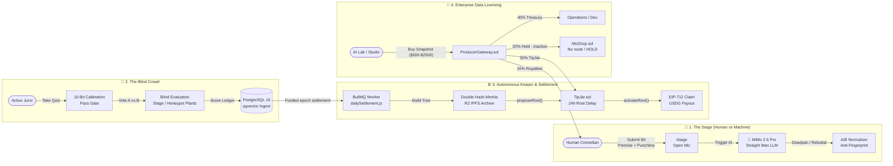

<div align="center">


# HAHA: AI Comedy Lab

**Autonomous AI Comedy Benchmark & Proof-of-Humor Arena on Robinhood Chain**

*Can you fool the machine? Human comedians take the mic against an AI Straight Man. Blind crowds jury. Real Merkle rewards flow to the funny.*

🎤 **The Stage:** [`/stage`](https://haha.asifaq.com/stage) · 👥 **The Crowd:** [`/crowd`](https://haha.asifaq.com/crowd) · 💰 **TipJar:** [`/tipjar`](https://haha.asifaq.com/tipjar) · 🏛️ **The Joke Vault:** [`/vault`](https://haha.asifaq.com/vault) · 💼 **Producers B2B:** [`/producers`](https://haha.asifaq.com/producers) · 🏆 **Leaderboard:** [`/leaderboard`](https://haha.asifaq.com/leaderboard)

[](#-live-robinhood-mainnet-deployments-chain-id-4663)
[](#-tech-stack)
[](#-overview)
[](#-system--settlement-architecture)
[](#-smart-contracts--verification)
[](#-license)

</div>

---

## ⚡ Overview

**HAHA** is the world's first decentralized benchmark for computational humor and human comedic intuition, deployed natively on **Robinhood Chain** (Mainnet `4663` / Testnet `46630`):

1. **The Open Mic Stage (`/stage`):** Comedians craft original jokes structured across *Premise*, *Setup*, *Punchline*, and *Subtext*. They battle **The AI Straight Man** (powered by low-latency Xiaomi MiMo 2.6 Pro), which attempts to deconstruct, explain, or deadpan the humor.
2. **Double-Blind Crowd Evaluation (`/crowd`):** Jurors sign in with a wallet and pass a 10-case calibration quiz (8/10). They review blinded A/B normalized punchlines. Juror access does not require a HAHA stake; calibration/plant checks help detect low-quality participation.
3. **Funded Merkle TipJar Payouts (`/tipjar`):** Eligible outcomes may enter a settlement epoch. USDG claims require verified funding, a finalized epoch, and an activated Merkle root; no payout is available or promised while the TipJar is empty.
4. **B2B Licensing (`/producers`):** AI research labs and entertainment studios can purchase data snapshots via `ProducerGateway.sol` ($500 to $2,500 USDG). Payments are split by contract: 40% operations/treasury, 30% general TipJar, 10% contributor royalty reserve, and 20% MicDrop hold. The MicDrop allocation is inactive/HOLD; there is no configured HAHA market route or automatic buyback.

---

## 🏛️ Core Value Proposition & Game Theory

* **Proof-of-Humor as an AI Frontier:** Humor is the hardest cognitive frontier for large language models because it requires situational subtext, cultural timing, and misdirection. HAHA turns comedy into an objective, incentivized on-chain benchmark.
* **Double-Blind Text Normalization:** Human bits and LLM reactions undergo strict A/B style normalization (stripping distinct punctuation, capitalization, and formatting tells) so jurors evaluate pure comedic timing rather than prompt artifacts.
* **Participation Quality:** Calibration cases and plant-bank checks help detect suspicious voting. This is not a guarantee of personhood, and juror eligibility does not require an on-chain HAHA stake.
* **Gas-Efficient Cumulative Merkle Distribution:** Instead of issuing expensive per-bit transactions, HAHA uses cumulative Merkle trees (`keccak256(keccak256(account, cumulativeMicro))`). Winners claim anytime using EIP-712 typed signatures with minimal on-chain gas overhead.
* **Real Commercial Cashflow (Zero Inflationary Ponzi):** Reward pools are backed by verified B2B revenue and direct USDG settlement inflows, never unbacked minting.

---

## 🔬 System & Settlement Architecture



### End-to-End Execution Pipeline

1. **Submission & Verification:** The comedian authors a joke. The AI Straight Man generates its take in under 800ms. Both punchlines are normalized and queued for blind voting.
2. **Jury Consensus:** Jurors vote blind on which punchline landed harder. When consensus passes the confidence threshold, the bit is scored. Bits outperforming the AI become `KILLED_IT`.
3. **Settlement & Merkle Publishing:** The worker processes verified funding receipts and eligible outcomes. It creates a Merkle root only when the epoch has funded rewards, then archives the manifest and calls `TipJar.proposeRoot()`.
4. **Veto Delay & Permissionless Activation:** A 24-hour timelock window allows verification. After the delay, any keeper or caller executes `activateRoot()`.
5. **Claiming:** Comedians and calibrated jurors claim their accumulated USDG directly to their Web3 wallets.

---

## 🔀 Game Loops & Roles

| Feature | The Comedian (`/stage`) | The Crowd Juror (`/crowd`) | Enterprise Producer (`/producers`) |
|---|---|---|---|
| **Role** | Authors original comedy bits | Evaluates punchlines blind | Licenses humor RLHF datasets |
| **Requirements** | Connected Web3 Wallet | 10-Question Calibration Quiz | USDG payment via `ProducerGateway` |
| **Incentive** | 80% General TipJar + 10% Royalties | 20% Crowd Allocation Pool | Verified high-nuance humor data |
| **Risk / Slashing** | Plagiarism check / AI copy flag | Calibration and plant-bank quality checks | Encrypted delivery with key verification |
| **Settlement** | Cumulative EIP-712 Claim | Cumulative EIP-712 Claim | Autonomous on-chain access grant |

---

## 🖥️ Platform Interfaces

### 1. The Comedy Arena (`/stage`)
- **Interactive Mic Desk:** Step onto the virtual stage with dynamic spotlights, real-time typing indicators, and immediate AI Straight Man rebuttals.
- **Roast & Subtext Visualizers:** Displays setup breakdown, comedic subtext, and stylistic tags.

### 2. The Blind Crowd (`/crowd`)
- **Calibration Gauntlet:** 10 curated comedy tests ensuring human jurors possess authentic comedic discernment.
- **Distraction-Free A/B Desk:** Side-by-side punchline evaluation with keyboard shortcuts (`1` for Option A, `2` for Option B).

### 3. The Payout Portal (`/tipjar`)
- **Transparent Reward Ledger:** Displays total historical inflows, current active epoch, and pending Merkle root status.
- **One-Click EIP-712 Claims:** Cryptographically claims accumulated USDG without manual proof construction.

### 4. The Joke Vault (`/vault`)
- **Cryptographic Comedy Registry:** Publicly browse, search, and verify all bits minted into the canon, backed by keccak256 hashes and on-chain timestamp proofs.

### 5. Enterprise Producers Portal (`/producers`)
- **Self-Serve Dataset Licensing:** AI teams acquire structured JSONL comedy benchmarks in tiers:
  - *Tier 1: Quick Roast ($500 USDG)*: Curated benchmark bits with juror consensus.
  - *Tier 2: Season Pass ($1,200 USDG)*: Full season dataset including holdout evaluations.
  - *Tier 3: Joke Vault Enterprise ($2,500 USDG)*: Complete canon with raw human vs. AI preference pairs.

---

## 📁 Repository Structure

```text
HAHA/
├── app/                           # Next.js 16 App Router (51 routes)
│   ├── api/                       # REST & Cron endpoints (SIWE, Bits, Crowd, Rewards, Vault)
│   │   ├── bits/                  # Submission, voting, appeal, report routes
│   │   ├── cron/                  # daily-settlement, five-minute-ops, sync-chain, weekly-vault
│   │   ├── crowd/                 # Onboarding, next-assignment, stake-check
│   │   ├── producers/             # B2B purchase verification & license keys
│   │   ├── rewards/               # Funding registration & Merkle claim proofs
│   │   └── tipjar/                # Summary stats & contract parameters
│   ├── crowd/                     # Blind evaluation & calibration UI
│   ├── stage/                     # Comedian open mic UI
│   ├── tipjar/                    # Payout desk & Merkle claimer
│   ├── vault/                     # Public Joke Vault registry
│   ├── producers/                 # B2B dataset purchase portal
│   └── leaderboard/ seasons/      # Global rankings & season archives
├── components/                    # High-polish visual UI components
│   ├── landing/                   # Hero, pipeline diagrams, live spotlight feed, FAQ
│   ├── wallet/                    # 2-Row Veil-style multi-wallet modal with balances
│   └── ui/                        # Accessible Radix + Tailwind components
├── contracts/                     # Solidity 0.8.24 Foundry Suite (12 suites, 80 tests)
│   ├── src/
│   │   ├── HAHA.sol               # Fixed-supply 1B HAHA ERC-20 token
│   │   ├── CrowdStaking.sol       # Juror & comedian staking & slash engine
│   │   ├── TipJar.sol             # Merkle-based cumulative USDG payout vault
│   │   ├── FeeSplitter.sol        # Revenue splitter (70% TipJar / 30% MicDrop)
│   │   ├── MicDrop.sol            # Buyback & burn controller with reserve caps
│   │   ├── ProducerGateway.sol    # B2B license purchases & 40/30/10/20 split
│   │   ├── VaultRegistry.sol      # On-chain joke snapshot registry
│   │   └── V4BuybackAdapter.sol   # Uniswap V4 multi-hop buyback adapter
│   ├── script/                    # Production deployment scripts
│   └── test/                      # Comprehensive unit, fuzz, & integration tests
├── worker/                        # Distributed background queue engine
│   ├── jobs/                      # dailySettlement, fiveMinuteOps, syncChain, weeklyVault
│   ├── lib/                       # chain, funding, merkle, micDrop, rewards
│   └── queues.js                  # BullMQ Redis job scheduler
├── prisma/                        # Database schema & PostgreSQL migrations
├── docs/                          # Architecture specs, budgets, & runbooks
│   ├── MAINNET-HANDOFF.md         # Production cutover runbook & live ledger
│   ├── CA-ONLY-BUDGET.md          # Capital requirements & gas estimates
│   └── CA-ONLY-OPERATIONS.md      # Operational runbook for token & buyback routing
├── scripts/                       # Operational & verification scripts
└── tests/                         # Node.js automated test suites
```

---

## 🛠️ Tech Stack

- **Frontend & App Engine:** Next.js 16.4.2 (App Router, Turbopack) + React 19 + TypeScript 5 (Strict)
- **Styling & Motion:** Tailwind CSS v4 + Framer Motion + Lucide Icons + Canvas Visualizers
- **Web3 EVM Client:** Viem 2.x + Wagmi + EIP-6963 Multi-Wallet Provider + EIP-712 Signatures
- **Smart Contracts:** Solidity `0.8.24` + Foundry Forge (via WSL Ubuntu 22.04)
- **AI / LLM Engine:** Xiaomi MiMo 2.6 Pro (Low-Latency UltraSpeed Endpoint)
- **Database & Search:** PostgreSQL 16 with `pgvector` (HNSW cosine similarity embeddings)
- **Queue & Scheduling:** Redis 7 + BullMQ Worker Cluster
- **Storage:** Cloudflare R2 (S3-compatible immutable encrypted dataset snapshots)
- **Production Server:** Self-Hosted Ubuntu 24.04 LTS (Tencent Cloud VPS `43.134.60.117`) + Docker Compose + Caddy TLS

---

## 🌐 Live Robinhood Mainnet Deployments (Chain ID: 4663)

**Deployed on Robinhood Chain Mainnet (`4663`)**
*Contract addresses are live; some features remain intentionally inactive (no token market, MicDrop HOLD, no funded reward epoch):*

| Contract | Address | Explorer Link |
|---|---|---|
| **HAHA Token (Fixed 1B)** | `0xd2Da320EF90FB76809587C830A33a49512bA90D9` | [View on Blockscout](https://robinhoodchain.blockscout.com/address/0xd2Da320EF90FB76809587C830A33a49512bA90D9) |
| **CrowdStaking** | `0xe861a2c5d2114A76779d91d416c750bE7D3f7d88` | [View on Blockscout](https://robinhoodchain.blockscout.com/address/0xe861a2c5d2114A76779d91d416c750bE7D3f7d88) |
| **TipJar (Merkle Payouts)** | `0xda4762e4205aFf2d8CB9177cDcE6d69A23068bbE` | [View on Blockscout](https://robinhoodchain.blockscout.com/address/0xda4762e4205aFf2d8CB9177cDcE6d69A23068bbE) |
| **ProducerGateway (B2B)** | `0x71826870a70064F0657EF527AFd9d1029Ae950de` | [View on Blockscout](https://robinhoodchain.blockscout.com/address/0x71826870a70064F0657EF527AFd9d1029Ae950de) |
| **MicDrop (Buyback & Burn)**| `0x57dDE4efC1868A153be6b8d040d13A8d28993949` | [View on Blockscout](https://robinhoodchain.blockscout.com/address/0x57dDE4efC1868A153be6b8d040d13A8d28993949) |
| **V4BuybackAdapter** | `0x9754F06cA930B9190Dc622D26532Db77E6B76E2c` | [View on Blockscout](https://robinhoodchain.blockscout.com/address/0x9754F06cA930B9190Dc622D26532Db77E6B76E2c) |
| **VaultRegistry** | `0x27e5ADf5F3BfEBFA7B7B81619CA68a97CD1866D6` | [View on Blockscout](https://robinhoodchain.blockscout.com/address/0x27e5ADf5F3BfEBFA7B7B81619CA68a97CD1866D6) |
| **FeeSplitter** | `0xE9a827aC2834fFD30DDa5b7d710dbfbE43afe144` | [View on Blockscout](https://robinhoodchain.blockscout.com/address/0xE9a827aC2834fFD30DDa5b7d710dbfbE43afe144) |
| **USDG Token (Canonical)** | `0x5fc5360D0400a0Fd4f2af552ADD042D716F1d168` | [View on Blockscout](https://robinhoodchain.blockscout.com/address/0x5fc5360D0400a0Fd4f2af552ADD042D716F1d168) |

### 🚀 Broadcast Transactions

- **HAHA Token Deployment:** [`0x89a2a1e6961d2bb09724ed8a9163b42910953e2c500d36505bdb5d0067ed7dd3`](https://robinhoodchain.blockscout.com/tx/0x89a2a1e6961d2bb09724ed8a9163b42910953e2c500d36505bdb5d0067ed7dd3)
- **CrowdStaking Deployment:** [`0x6c8222ca48bb305c3f1fef7b7a0da577e3ccf55153d3a43d75355225b39a525a`](https://robinhoodchain.blockscout.com/tx/0x6c8222ca48bb305c3f1fef7b7a0da577e3ccf55153d3a43d75355225b39a525a)
- **Core Suite Broadcast Receipt:** Stored in `contracts/broadcast/DeployMainnet.s.sol/4663/run-latest.json`.

---

## 🧪 Live Robinhood Testnet Deployments (Chain ID: 46630)

| Contract | Address | Explorer Link |
|---|---|---|
| **TipJar** | `0x03f26784cFE5808DC4A669bbB6D410d08765a675` | [View on Testnet Explorer](https://explorer.testnet.chain.robinhood.com/address/0x03f26784cFE5808DC4A669bbB6D410d08765a675) |
| **FeeSplitter** | `0xC79D6Bc6955844cB396cF67a66eD7f084fA19C7d` | [View on Testnet Explorer](https://explorer.testnet.chain.robinhood.com/address/0xC79D6Bc6955844cB396cF67a66eD7f084fA19C7d) |
| **MicDrop** | `0xCEc9922655BCfFD4cec6A6aA1b9e992C1dfa1d28` | [View on Testnet Explorer](https://explorer.testnet.chain.robinhood.com/address/0xCEc9922655BCfFD4cec6A6aA1b9e992C1dfa1d28) |
| **USDG (Mock)** | `0x6b72879a2144049a10b176a827f1603bdb0b72ab` | [View on Testnet Explorer](https://explorer.testnet.chain.robinhood.com/address/0x6b72879a2144049a10b176a827f1603bdb0b72ab) |

---

## 🚀 Quickstart & Local Development

### Prerequisites

- **Node.js:** `v20.x` or later (tested on v24.15.0)
- **PostgreSQL 16** with `pgvector` extension
- **Redis 7** (for BullMQ queues)
- **Foundry:** `forge`, `cast`, `anvil` (installed via `foundryup`)

### 1. Clone & Install Dependencies

```bash
git clone https://github.com/HAHAlabstech/haha.git
cd haha
npm install
```

### 2. Configure Environment

Copy `.env.example` to `.env.local`:

```bash
cp .env.example .env.local
```

### 3. Database Migrations

Apply Prisma schema migrations to your local or staging PostgreSQL instance:

```bash
npx prisma migrate deploy
npx prisma generate
```

### 4. Run Smart Contract Test Suite (Foundry)

```bash
cd contracts
forge test
```

### 5. Run Backend & Worker Integration Tests

```bash
node --test tests/micdrop.test.cjs tests/chain.test.cjs tests/funding.test.cjs tests/rewards.test.cjs tests/pons-launch.test.cjs
node scripts/verify-funding-db.cjs
```

### 6. Start Web Application & Worker

```bash
# Terminal 1: Next.js Frontend
npm run dev

# Terminal 2: BullMQ Worker (Local dev should set WORKER_CHAIN_WRITES=off)
npm run dev:worker
```

Open [http://localhost:3000](http://localhost:3000) to view the application.

---

## 🧪 Quality Assurance & Test Verification

The HAHA codebase enforces strict test coverage and zero-error verification across all system tiers:

```bash
# 1. Foundry Solidity Suites: 12 test suites, 80 tests passing (including 10,000-run fuzz tests)
cd contracts && forge test --summary

# 2. Node.js Backend & Routing Suites: 26 tests passing
node --test tests/*.test.cjs

# 3. Real PostgreSQL Atomic Rollback & Idempotency: PASS
node scripts/verify-funding-db.cjs

# 4. Strict TypeScript Typecheck: 0 errors
npm run typecheck

# 5. Production Next.js Turbopack Build: 51 routes validated green
npm run build

# 6. Mainnet Preflight Gate Check: PASS
node scripts/preflight-mainnet.mjs
```

---

## 🔒 Security, Safety Gates & Auditing

- **Double-Hash Leaf Preimage Defense:** `TipJar` leaves are computed as `keccak256(keccak256(account, cumulativeMicro))` to protect against second-preimage attacks on arbitrary Merkle proof libraries.
- **Root Activation Timelock Delay:** Every proposed Merkle root must wait 24 hours on mainnet (`600s` on testnet) before activation, providing ample veto window for emergency interventions.
- **2% Pool Reserve Buyback Cap:** `MicDrop.executeBuyback` enforces mathematical caps: no single buyback may exceed 2% of active pool reserves or trigger >1% price impact.
- **Non-Reentrant & Non-Custodial:** Core contracts never hold arbitrary user funds; all reward claims are strictly pull-based directly to recipient wallets.
- **Fail-Closed Routing:** Multi-hop Uniswap V4 routes that fail connection or slip below `minHopPriceX36` immediately roll back without draining funds.

---

## 📄 License

This repository is licensed under the [MIT License](LICENSE).
Comedic data snapshots and canon datasets licensed via `ProducerGateway.sol` are governed by the HAHA Commercial Research License.
